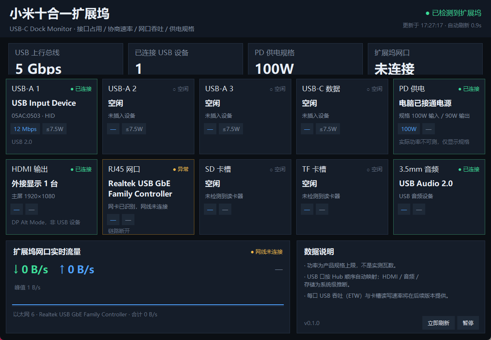

# 小米十合一扩展坞监控（Xiaomi Dock Monitor）

一个 Windows 小工具：实时显示小米 Type-C 十合一扩展坞的**接口占用、设备身份、USB 协商速率、千兆网口与存储吞吐、供电状态**。

> 状态：`v0.1.0` PoC / 可运行
> 平台：Windows 10 / 11（x64）
> 技术栈：Python 3.10+ / Tkinter / ctypes（注册表枚举 + USB Hub IOCTL）



> 截图来自当前版本：设备区按扩展坞**俯视实物方位**绘制（正面朝上）。短边左侧是上行 Type-C 连接线，右侧是 RJ45 网口；长边上侧从左到右为供电 Type-C、数据 Type-C、USB-A 1/2/3；长边下侧从左到右为 HDMI、SD/TF 卡槽（同槽位 TF 在上、SD 在下）、3.5mm 音频。点击任一接口，下方显示该口的设备与 Hub 映射详情。

## 它显示什么

- **按俯视实物方位的 10 个接口状态卡**：短边左侧上行 Type-C、短边右侧 RJ45；长边上侧供电 Type-C / 数据 Type-C / 3×USB-A；长边下侧 HDMI / SD·TF / 3.5mm 音频
- **点击接口查看详情**：设备名、VID/PID、协商速率、功率规格、Hub 端口映射；支持暂停刷新与立即刷新
- **每个 USB 口的物理编号、设备名、VID/PID、链路速率**（1.5Mbps / 12Mbps / 480Mbps / 5Gbps）
- **网口实时收发速率**（RTL8153 等 USB 网卡）
- **可移动存储（SD/TF）状态**
- **显示输出 / 音频设备状态**
- **供电状态与功率规格**：PD 100W 输入、90W 输出、单口 5V⎓1.5A、外设预算约 10W

## 快速开始

```bat
cd E:\GitHub\xiaomi-dock-monitor
run.bat
```

或者：

```bat
cd E:\GitHub\xiaomi-dock-monitor
python -m pip install -e .
python -m dockmon
```

命令行查看当前快照（不开界面）：

```bat
run.bat --dump
```

## 托盘与开机自启

启动后托盘出现扩展坞图标，右键菜单提供「打开监控面板 / 隐藏窗口 / 开机自启 / 退出监控」。关闭窗口只会隐藏到托盘，不会退出程序。

```bat
:: 启动时直接驻留托盘，不弹出主窗口
python -m dockmon --tray
```

- 「开机自启」写入 `HKCU\Software\Microsoft\Windows\CurrentVersion\Run`，命令按当前运行方式（源码 / exe）自动生成，始终带 `--tray`，登录后不会弹窗。
- 同一时间只允许一个实例：重复启动会唤起已有窗口，然后自身退出。
- 若 `pystray` / Pillow 不可用，则托盘功能自动降级为普通窗口（关闭即退出）。

## 打包成单文件 exe

```bat
python -m pip install "pyinstaller>=6"
python scripts/build_exe.py
```

产物为 `dist\dockmon.exe`：单文件、无控制台窗口，图标与版本信息在打包时自动生成，可直接分发；同样支持 `--tray` 与开机自启。

## 它是怎么拿数据的

| 数据 | 来源 |
|---|---|
| Hub / 端口连接状态 | 注册表枚举 `Enum\USB`，打开 `GUID_DEVINTERFACE_USB_HUB`，调用 `IOCTL_USB_GET_NODE_CONNECTION_INFORMATION_EX` |
| 端口上的设备实例 | `IOCTL_USB_GET_NODE_CONNECTION_DRIVERKEY_NAME` → 注册表 `Driver` 值映射 |
| 物理接口 ↔ Hub 端口 | `config/port_map.json`（顶层 SS/USB2 Hub 的 PID + 端口号），实测标定，不按枚举顺序猜 |
| 协商速率 | `IOCTL_USB_GET_NODE_CONNECTION_INFORMATION_EX_V2` 的 `Flags` + `EX` 的 `Speed` |
| 设备名称/类别 | `Enum\USB` 下的 `FriendlyName` / `DeviceDesc` / `ClassGUID` |
| 网口吞吐 | `psutil.net_io_counters()`；网卡名称由一次 `Get-NetAdapter` 探测得到 |
| 供电状态 | `psutil.sensors_battery()`；功率数字为产品规格，**不是实测** |
| 显示输出 | `EnumDisplayDevicesW` |
| SD/TF | `GetLogicalDrives` + `GetDriveTypeW` |

## 重要限制

1. **功率不可实测**。这个扩展坞没有电量计/遥测固件，Windows 也不向普通应用暴露 PD 合同。UI 中的“功率”全部是**规格上限**。
2. **HDMI 不在 USB 树里**。它走 DP Alt Mode，只能通过显示子系统推断“有没有外接显示”。
3. **SD/TF 与音频是系统级推断**。可移动盘可能是 U 盘；音频只检测 USB 音频设备。
4. **USB 设备到物理口的映射是实测配置**。10 合 1 的 3×USB-A + 1×USB-C 与内部 Hub 端口没有公开对应表；本仓库按“供电 Type-C=1、Type-C 数据=2、USB-A=3–5”编号，并在 `config/port_map.json` 中记录实测映射。当前 2、3、4、5 号口两侧均已标定，未标定端口仍会在界面提示。
5. **USB 每口“实时吞吐”尚未实现**。v0.1 给出协商速率 + 网口实时吞吐；每口 USB 吞吐需要 ETW（见 `docs/TODO.md` 的 P1）。

## 文档

- [待办与可行性清单](docs/TODO.md)
- [物理接口编号与 Hub 端口映射](docs/port-mapping.md)
- [可行性分析](docs/feasibility.md)

## License

MIT
